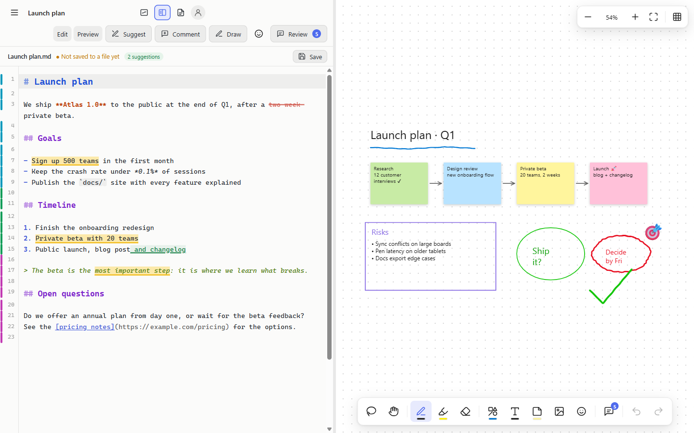
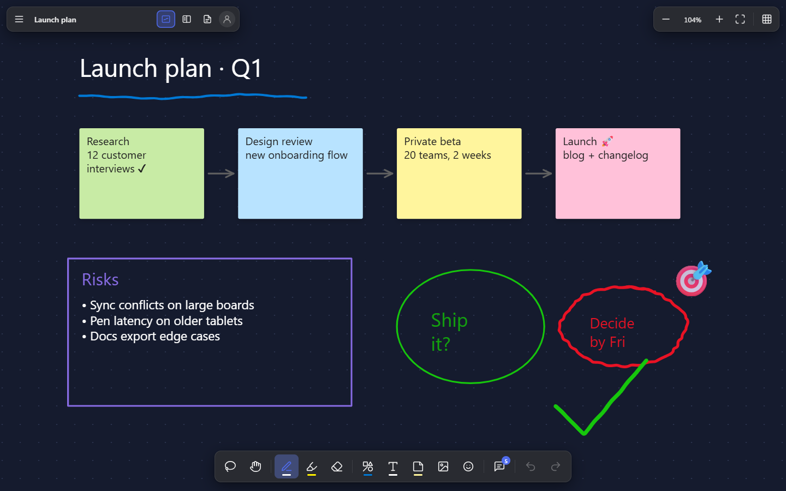
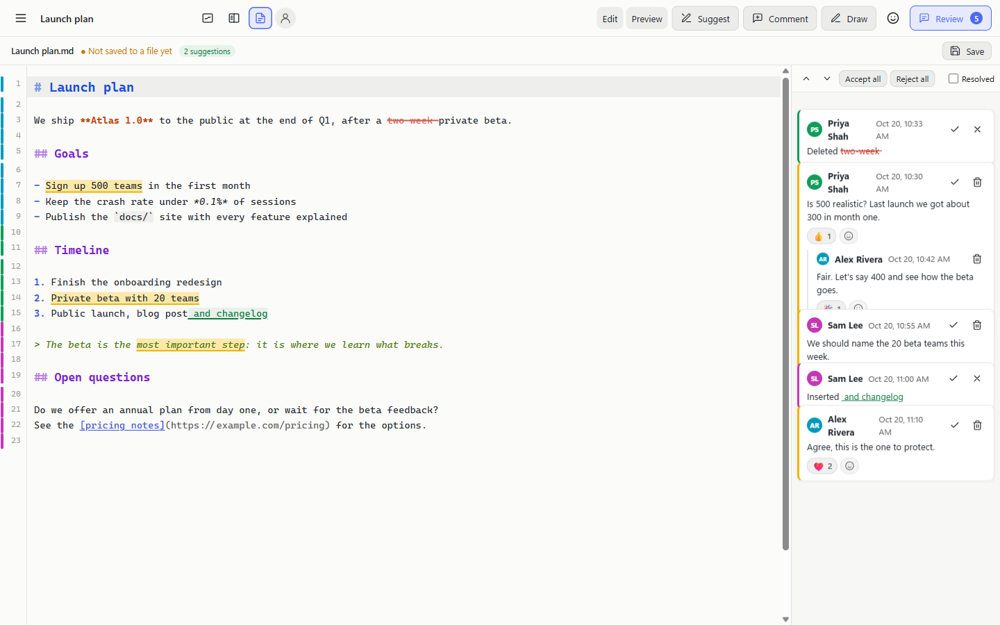
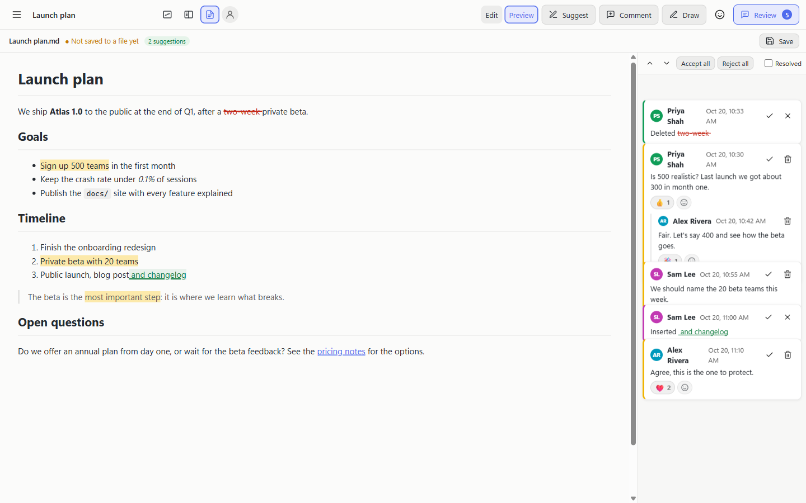
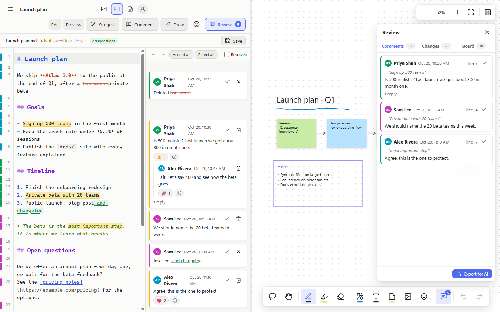
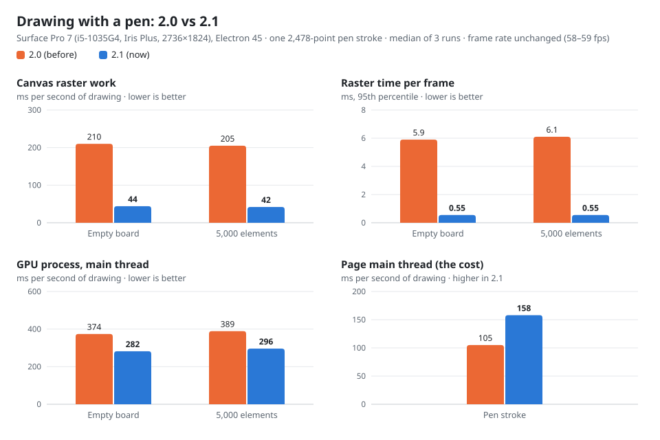
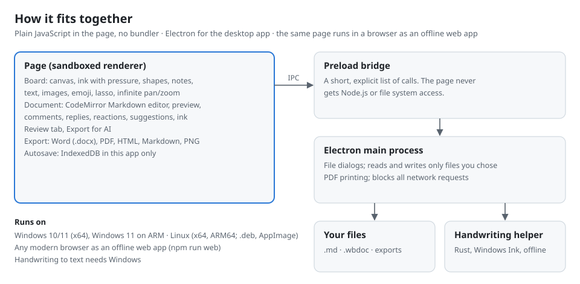

# ZP Whiteboard

An infinite whiteboard and a Markdown editor side by side, with Word-style review: comments, replies, reactions, @mentions and suggested changes. Draw with a pen (pressure, palm rejection, handwriting to text on Windows), write and review documents, then export to Word, PDF or a bundle for your AI assistant.

It runs offline as a desktop app on Windows and Linux, or in any modern browser. It never talks to the network.



> **Version 2.1, the first public release.** It's developed and tested on a Surface Pro 7, and there's plenty of room to improve. See [Status and what's next](#status-and-whats-next). Issues and ideas are welcome.

## Contents

- [Download and install](#download-and-install)
- [Using ZP Whiteboard](#using-zp-whiteboard): [the board](#the-board), [documents](#documents), [review](#review), [exporting](#exporting), [saving your work](#saving-your-work), [shortcuts](#keyboard-shortcuts)
- [Tested on](#tested-on)
- [Performance](#performance)
- [How it's built](#how-its-built)
- [Build from source](#build-from-source)
- [Status and what's next](#status-and-whats-next)
- [Licence](#licence)

## Download and install

Ready-made installers are on the download page: **https://zeropodnews.com/whiteboard**. They're the **full edition**: everything in this repository, plus encrypted and signed documents (`.swbdx`), a closed-source module that isn't part of this repository. Either edition installs over the other and keeps your boards.

| System | Package | Notes |
|---|---|---|
| Windows 10/11, x64 | `ZP-Whiteboard-Setup-2.1.0-x64.exe` (installer) or `ZP-Whiteboard-Portable-2.1.0-x64.exe` (single file) | The installer adds a Start menu entry and opens `.wbdoc` files |
| Windows 11 on ARM | `ZP-Whiteboard-Setup-2.1.0-arm64.exe` or the portable `-arm64.exe` | Runs natively; the small handwriting helper runs through Windows' x64 emulation |
| Debian, Ubuntu and derivatives | `zp-whiteboard_2.1.0_amd64.deb` / `_arm64.deb` | `sudo apt install ./zp-whiteboard_2.1.0_amd64.deb` |
| Other Linux | `ZP-Whiteboard-2.1.0-x86_64.AppImage` / `-arm64.AppImage` | `chmod +x`, then run. On Ubuntu 23.10 and later use the .deb: AppArmor blocks the sandbox an AppImage needs |
| Any browser | none | Build from source and run `npm run web`, then *Install as app* from the menu |

The builds aren't code-signed yet, so Windows SmartScreen asks the first time: *More info → Run anyway*. Building it yourself takes a few minutes: see [Build from source](#build-from-source).

## Using ZP Whiteboard

### The board



- **Draw**: pen with pressure, highlighter, eraser (the stylus's eraser end works too). Once you've used a pen, a finger pans instead of drawing, and a pen beats a resting palm.
- **Shapes**: rectangle, ellipse, triangle, line and arrow. Hold Shift for squares, circles and straight angles.
- **Sticky notes, text and emoji** (press `M` for the emoji picker), and **images**: insert, paste or drop them.
- **Select** with the lasso, then move, resize, recolor, duplicate (Ctrl+D), reorder or delete.
- **Handwriting to text** (Windows, offline): select handwriting and choose *To text*. *To shapes* turns drawn rectangles, circles and triangles into clean shapes.
- **Infinite canvas**: pan with the hand tool, Space+drag, or one finger; zoom with Ctrl+wheel or a pinch. Ctrl+0 for 100%, Ctrl+1 to fit.
- **Six board colors** (White, Paper, Mist, Slate, Chalkboard, Night) and four patterns (none, dots, grid, lines). Ink switches between black and white with the board so it stays visible.

### Documents



- **Open a Markdown file** with *Open…* (Ctrl+O) or by dropping it on the window. Choose to put it beside a new blank board or beside the current one.
- **Three layouts**, switched by the buttons next to the name: board only, document and board side by side (drag the divider), and document only.
- **Edit** with Markdown colors (every heading level, bold, italic, code, quotes, links and list bullets has its own color, in light and dark), or switch to **Preview**:

  

- **Save Markdown** (Ctrl+S) writes back to the same `.md` file. Pending suggestions are written as accepted text there; the workspace keeps them as suggestions.
- **Who edited what**: every changed line gets a colored bar in the gutter. Hover it to see who and when. *Accept changes (reset tracking)* starts again from the current text.
- **Draw on documents**: *Draw* puts a pen, highlighter, eraser and *Write* pen over the preview. Ink sticks to the paragraph it's on and moves with it. On Windows, writing with the *Write* pen turns into text after a short pause.
- **Your name** (the avatar button) labels your edits, comments, suggestions, ink and board items. It's asked for the first time it's needed, never taken silently.

### Review



- **Comments**: select text and press *Comment* (Ctrl+Alt+M). They sit in a margin next to the text, with replies, emoji reactions, @mentions, resolve and reopen, and Next/Previous (Alt+↓ / Alt+↑). *Review* shows or hides the margin.
- **Suggest** (Ctrl+Shift+E) turns your edits into suggestions: insertions underlined, deletions struck through, in the author's color, each with Accept or Reject, plus *Accept all* and *Reject all*.
- **The Review tab** on the board toolbar lists every comment (open and resolved), every pending suggestion, who edited which lines, and what each person added to the board. Click an item to jump to it.
- **Merge comments from a copy** brings back the threads a reviewer added to their copy of the workspace.

### Exporting

| Export | What you get |
|---|---|
| **Word (.docx)** | Real Word comments (with replies and resolved state) and tracked changes, or the final text |
| **PDF** and **web page** | The document with its review markup, or final; document ink included |
| **Markdown** | The text with suggestions applied |
| **Board as PNG** | The whole board as an image |
| **Export for AI** (Ctrl+E) | `name.review.md` + `name.board.png`: open and resolved comments with quotes and line numbers, pending suggestions, who edited which lines, a diff against the original, the board sketch, the text of notes and text boxes, and the full current document. The desktop app also puts a ready-made prompt on your clipboard for Claude Code or any other AI model or agent |

### Saving your work

- Everything is **autosaved** on your device, per workspace, under *My workspaces*. Nothing is uploaded anywhere.
- **Save workspace (.wbdoc)** writes the document, board, comments, suggestions and ink to one file you can send or keep. Opening a `.wbdoc` brings it all back.
- On the desktop the app reads and writes only files you chose: ones you opened, dropped on the window, or picked in a save dialog. A file someone sends you can't decide where your next save goes.

### Keyboard shortcuts

| Action | Keys |
|---|---|
| Open, save Markdown | Ctrl+O, Ctrl+S |
| Export for AI | Ctrl+E |
| Undo, redo | Ctrl+Z, Ctrl+Y |
| Copy, cut, paste, duplicate | Ctrl+C, Ctrl+X, Ctrl+V, Ctrl+D |
| Zoom 100% / fit | Ctrl+0 / Ctrl+1 |
| Comment on the selection, post a comment | Ctrl+Alt+M, Ctrl+Enter |
| Suggesting on or off | Ctrl+Shift+E |
| Next / previous comment | Alt+↓ / Alt+↑ |
| Emoji picker on the board | M |
| All shortcuts | ? |

## Tested on

| Machine | System | What was checked |
|---|---|---|
| **Microsoft Surface Pro 7**: Intel Core i5-1035G4 (4 cores, 8 threads), 16 GB RAM, Intel Iris Plus Graphics, 12.3" 2736×1824 touch screen, Surface Pen | Windows 11 Pro (x64) | Where it's developed and tested: pen, touch and palm rejection, handwriting recognition, all features, the installer and portable builds, and every performance number below |
| **Raspberry Pi 5 Model B**, 8 GB | Debian 13 "trixie" (arm64) | The app from the .deb and the AppImage, started on a virtual display (Xvfb): page loads with no errors, opening files passed as `file://` addresses (as file managers do), saving (keeps file permissions, follows symlinks), the `.deb` contents and file associations |
| Windows 11 on ARM | | ARM64 installer and portable builds made; **not yet run on ARM hardware** |
| x64 Linux | | `.deb` and AppImage built from the same code; **not yet run on an x64 Linux machine** |

If you run it somewhere new, an issue saying whether it worked is a real help.

## Performance

Drawing is where a whiteboard has to feel instant. In 2.1 the stroke you're drawing is no longer repainted in full every frame: each new segment is drawn once and only the small area around the pen tip is refreshed.

<picture>
  <source media="(prefers-color-scheme: dark)" srcset="docs/img/drawing-performance-dark.svg">
  
</picture>

The trade-off is in the last panel: the page's own main thread does about 50% more per second while you draw, and the GPU process holds about 55 MB more. The frame rate stayed at 58 to 59 fps throughout.

The release before that (2.0) removed the lag on big boards. Measured on the same Surface Pro 7:

| | 1.1 | 2.0 and later |
|---|---|---|
| Drawing on a board with 2,000 / 5,000 elements | 2.3 / 0.8 fps | 60 / 60 fps |
| Pen latency with pressure, 2,000 elements | 455 ms | 9 ms |
| Panning a board with 2,000 elements | 3.5 fps | 60 fps |
| Worst autosave pause after a stroke, 5,000 elements | 2.6 s | 4 ms |

## How it's built

<picture>
  <source media="(prefers-color-scheme: dark)" srcset="docs/img/architecture-dark.svg">
  
</picture>

- **No network, no telemetry.** The desktop app blocks every web request; documents can't load remote images or reach file shares.
- **A narrow bridge.** The page runs sandboxed and never gets Node.js. It can only ask the main process for a short list of things, and only for file types it's allowed to handle.
- **Plain web code.** The UI is plain JavaScript and CSS with no bundler: [CodeMirror 5](https://codemirror.net/5/) for the editor, [marked](https://marked.js.org/) and [DOMPurify](https://github.com/cure53/DOMPurify) for Markdown, and a canvas renderer of its own for the board.
- **Handwriting recognition** is a small Rust program (`native/swbd-ink`) that uses Windows Ink analysis, offline.

| Path | What's there |
|---|---|
| `electron/` | The desktop shell: window, file access for files you chose, PDF printing, the handwriting helper |
| `index.html`, `styles.css` | The UI |
| `js/app.js` | The board: state, input, layers, layout, menus, files, export dialogs |
| `js/geometry.js`, `js/render.js` | Board model and drawing (incremental strokes, cached background) |
| `js/doc.js` | The document pane: editor, attribution, comments, suggestions, document ink |
| `js/export.js` | Word (.docx), HTML/PDF and Markdown export |
| `js/emoji.js`, `js/storage.js`, `js/platform.js` | Emoji picker, IndexedDB autosave, desktop/browser file access |
| `native/swbd-ink` | The handwriting helper (Rust, Windows) |
| `tools/` | Build helpers: vendored libraries, icons, native build, third-party notices |

## Build from source

You need [Node.js](https://nodejs.org/) 22 or later. For handwriting recognition on Windows you also need [Rust](https://rustup.rs/).

```sh
npm install          # also copies the libraries into vendor/
npm start            # run the desktop app
npm run web          # or run it in your browser at http://localhost:5180
```

Packages:

```sh
npm run native       # Windows: builds bin/swbd-ink.exe (handwriting)
npm run dist         # Windows x64: installer + portable in dist/
npm run dist:arm64   # Windows on ARM: installer + portable in dist/
npm run dist:linux   # Linux: .deb + AppImage for this machine's architecture
```

Build Linux packages on a machine of the architecture you're packaging for.

## Status and what's next

ZP Whiteboard 2.1 is the first public release. It does a lot already, and it has rough edges. Known limitations:

- **Handwriting to text is Windows-only**: it uses Windows Ink. Linux has no offline recognizer wired in yet.
- **Unsigned builds**, so Windows warns on first launch.
- **Windows on ARM and x64 Linux are built but not yet tested on real hardware** (see [Tested on](#tested-on)).
- **No macOS package.** The code is likely close, but it hasn't been built or tried.
- **One person at a time**: there's no live collaboration. Review travels with the `.wbdoc` file or the Word export.
- **English only.**
- **No automated test suite yet.** The app is checked with scripted runs on Windows and Linux (it starts cleanly, opens and saves files, the editions behave) and by hand.

Ideas for what's next: handwriting recognition on Linux, signed builds, a macOS package, automated UI tests, and better keyboard and screen-reader support. If something matters to you, open an issue.

## Licence

Copyright 2026 Zeropod. Licensed under the [Apache License, Version 2.0](LICENSE). ZP Whiteboard includes third-party software under its own licences: see [THIRD-PARTY-NOTICES.md](THIRD-PARTY-NOTICES.md).

Contact: jesone.dev@zeropodnews.com
